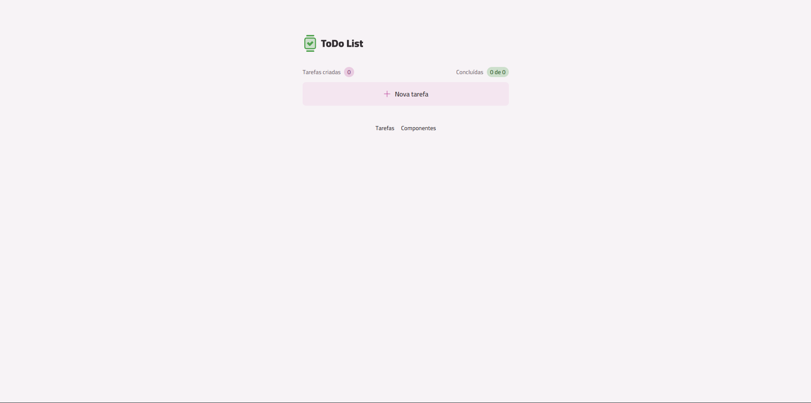

# ✅ ToDoList

Um aplicativo de lista de tarefas desenvolvido para praticar e aprimorar conhecimentos em desenvolvimento front-end com React e TypeScript.

## 🚀 Tecnologias utilizadas

- **React** — construção da interface
- **TypeScript** — tipagem estática e maior segurança no código
- **Vite** — ambiente de desenvolvimento e build
- **CSS** — estilização da aplicação

## ✨ Funcionalidades

- Gerenciamento de tarefas em uma interface simples e intuitiva
- Organização das tarefas do dia a dia

## 📸 Preview

<!-- Adicione uma captura de tela do projeto aqui futuramente -->



## 💻 Como executar o projeto

### Pré-requisitos

- Node.js instalado
- pnpm instalado

### Instalação

1. Clone o repositório:

   ```bash
   git clone https://github.com/lipefelizardo1/ToDoList.git
   ```

2. Entre na pasta do projeto:

   ```bash
   cd ToDoList
   ```

3. Instale as dependências:

   ```bash
   pnpm install
   ```

4. Inicie o servidor de desenvolvimento:

   ```bash
   pnpm dev
   ```

5. Acesse o endereço exibido no terminal, normalmente `http://localhost:5173`.

## 🌐 Deploy

O projeto está publicado na Vercel.

<!-- Insira aqui o link do site publicado -->

## 👨‍💻 Autor

**Lipe Felizardo**

- GitHub: [@lipefelizardo1](https://github.com/lipefelizardo1)
- Repositório: [ToDoList](https://github.com/lipefelizardo1/ToDoList)
